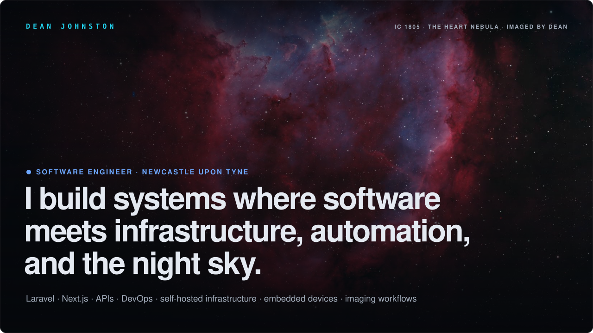
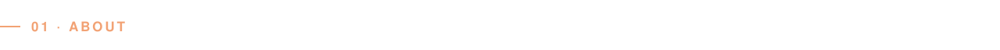
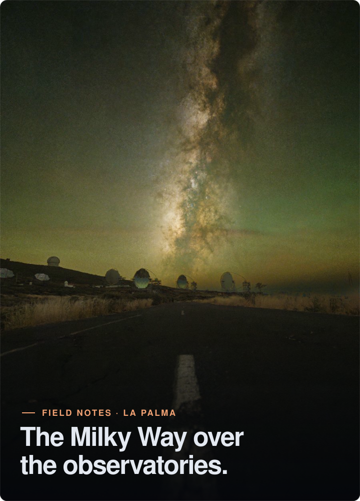
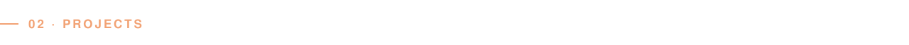
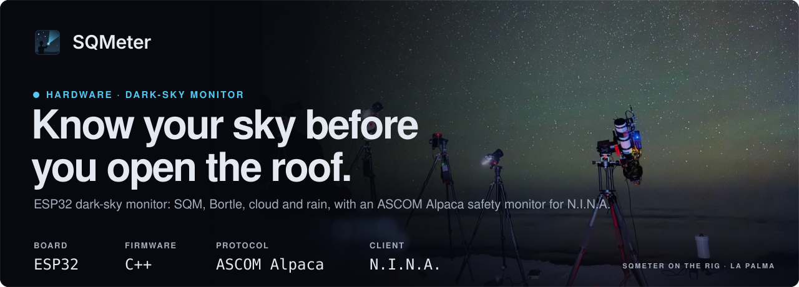
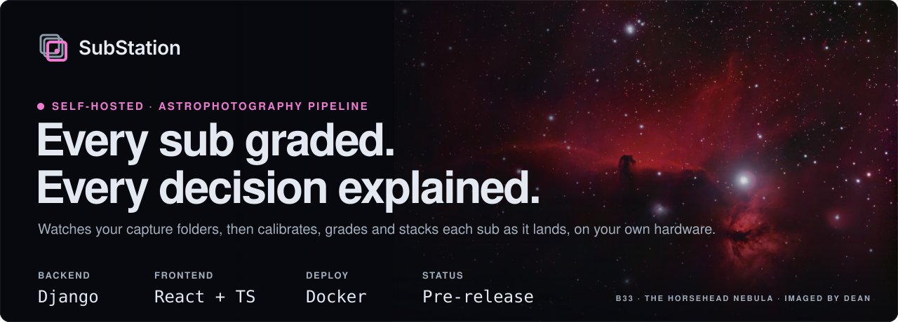
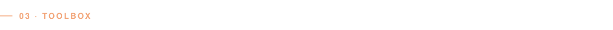
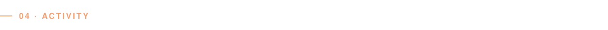
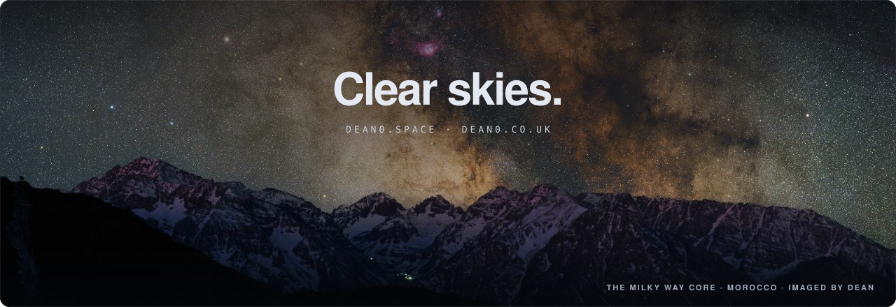

<!-- Built for github.com/DeanJ87. All visuals live in /assets. -->

  

  
  &nbsp;
  

 

<h3>Hi, I'm Dean 👋</h3>

Full-stack software engineer at <b><a href="https://github.com/KomodoHQ">Komodo Digital</a></b> in Newcastle upon Tyne, working across Laravel, Next.js, APIs, DevOps, self-hosted infrastructure, observability, embedded devices and imaging workflows.

When the sky is clear I'm outside with a camera. Most of my side projects start as fixes for my own astrophotography setup, and I share them in case they help someone else.

  🔭 &nbsp;Deep-sky and nightscape imaging 
  🛠️ &nbsp;ESP32s, sensors and self-hosted tools 
  📷 &nbsp;Photography when the clouds win

Prints and field notes live on <a href="https://dean0.space"><b>dean0.space</b></a>.

 

 

 

  

 

  
  

  

 

